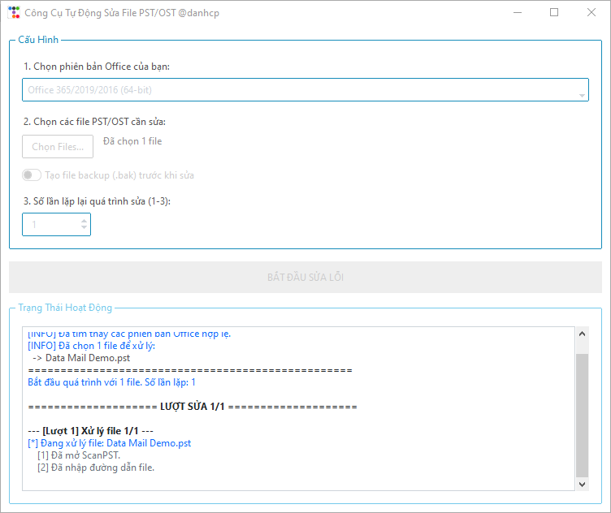

# Công Cụ Tự Động Sửa File PST/OST (SCANPST Auto Repair Tool)

Công cụ giao diện đồ họa (GUI) được viết bằng Python giúp tự động hóa tiện ích **`SCANPST.EXE` (Inbox Repair Tool)** của Microsoft. 

Ứng dụng hỗ trợ quét và sửa chữa hàng loạt (batch repair) các file dữ liệu Outlook (`.pst`, `.ost`) một cách tự động, thông minh, không làm gián đoạn công việc và không cần phải thao tác thủ công từng bước cho từng file.



---

## 🌟 Tính năng nổi bật

- **Giao diện hiện đại & Thân thiện:** Được xây dựng bằng `ttkbootstrap` (theme phẳng hiện đại), dễ sử dụng đối với cả người dùng phổ thông và kỹ thuật viên IT.
- **Tự động dò tìm qua Registry:** Tự động truy vấn Windows Registry để phát hiện chính xác vị trí `SCANPST.EXE` của hầu hết các phiên bản Microsoft Office (Office 365, 2024, 2021, 2019, 2016, 2013, 2010, 2007).
- **Hỗ trợ chọn file thủ công:** Nút *"Duyệt File..."* cho phép chỉ định file `SCANPST.EXE` ở bất kỳ thư mục tùy biến nào nếu cài đặt ở ổ đĩa khác.
- **Tự động phát hiện & Đóng Outlook:** Tự động kiểm tra xem tiến trình `OUTLOOK.EXE` có đang chạy hay không để nhắc người dùng đóng (hoặc tự động taskkill), tránh hiện tượng xung đột khóa file (File Lock).
- **Tùy chọn Backup chính xác:** Nhận diện và đồng bộ đúng trạng thái ô Checkbox tạo file backup (`.bak`) trong `SCANPST.EXE`, tự động bấm xác nhận ghi đè backup cũ nếu có.
- **Tối ưu cho file dung lượng lớn (Không giới hạn thời gian - No Hard Timeout):** Các file PST/OST từ 20GB – 50GB+ có thể mất nhiều giờ để rebuild bảng chỉ mục. Công cụ kiên nhẫn theo dõi tiến trình và không ngắt cưỡng bức theo thời gian, đồng thời ghi log thông báo định kỳ (Heartbeat).
- **Nút Dừng/Hủy an toàn:** Cho phép dừng toàn bộ tiến trình bất cứ lúc nào chỉ với một cú click chuột.
- **Xử lý hàng loạt & Vòng lặp:** Cho phép chọn cùng lúc nhiều file và thiết lập số lần lặp lại quá trình quét/sửa (từ 1 đến 10 lần) để khắc phục triệt để các lỗi phân mảnh tầng sâu.
- **Nhật ký thời gian thực (Real-time Log):** Khung hiển thị log có phân màu trực quan (`Thành công`, `Lỗi`, `Cảnh báo`, `Các bước`).

---

## 💻 Yêu cầu hệ thống

- **Hệ điều hành:** Windows 10 / Windows 11 (32-bit hoặc 64-bit).
- **Microsoft Office:** Máy tính cần có cài đặt Microsoft Office / Outlook vì công cụ này tự động hóa tiện ích `SCANPST.EXE` chính thức của Microsoft.

---

## 🚀 Hướng dẫn cài đặt & Chạy ứng dụng

### Cách 1: Chạy trực tiếp từ file thực thi (Khuyên dùng)

1. Mở thư mục `dist/`.
2. Chạy file `SCANPST.exe`.
3. Ứng dụng là dạng độc lập (Single Portable Executable), không yêu cầu cài đặt Python hay thư viện ngoài.

---

### Cách 2: Chạy từ mã nguồn Python (Dành cho nhà phát triển)

1. Cài đặt **Python 3.8+** (đảm bảo đã tích chọn *"Add Python to PATH"* khi cài đặt).
2. Cài đặt các thư viện phụ thuộc:
   ```sh
   pip install -r requirements.txt
   ```
3. Chạy chương trình:
   ```sh
   python scanpst.py
   ```

---

## 📖 Hướng dẫn sử dụng chi tiết

1. **Khởi chạy ứng dụng:** Mở `SCANPST.exe` hoặc chạy lệnh `python scanpst.py`.
2. **Chọn phiên bản Office:**
   - Ứng dụng sẽ tự động dò tìm vị trí `SCANPST.EXE` từ Registry và liệt kê trong danh sách.
   - Nếu bạn cài Office ở thư mục đặc biệt, hãy nhấn nút **"Duyệt File..."** để chọn file `SCANPST.EXE`.
3. **Chọn file PST/OST:**
   - Nhấn **"Chọn Files..."** để chọn một hoặc nhiều file `.pst`/`.ost` cần kiểm tra và sửa lỗi.
4. **Cấu hình tùy chọn:**
   - **Tạo file backup (.bak) trước khi sửa:** Bật nếu muốn tạo bản sao lưu an toàn trước khi sửa; tắt nếu ổ cứng của bạn sắp hết dung lượng.
   - **Số lần lặp lại quá trình sửa:** Đặt từ 1 đến 10 lần (Khuyên dùng: 2 đến 3 lần đối với các file PST bị lỗi nặng).
5. **Bắt đầu quá trình:**
   - Nhấn nút **"▶ BẮT ĐẦU SỬA LỖI"**.
   - Nếu Outlook đang mở, phần mềm sẽ hiển thị hộp thoại hỏi bạn có muốn tự động đóng Outlook không. Hãy chọn **Yes** để tiếp tục.
6. **Theo dõi trạng thái:**
   - Mọi thao tác click chuột, nhập file, tiến trình quét, sửa lỗi và thời gian thực hiện đều được hiển thị trong khung **"Trạng Thái Hoạt Động"**.
   - Cứ mỗi 60 giây, ứng dụng sẽ ghi nhận thông báo tiến trình để bạn an tâm rằng tác vụ vẫn đang chạy.
7. **Dừng lại giữa chừng (Nếu cần):**
   - Bạn có thể nhấn nút **"⏹ DỪNG LẠI"** bất cứ lúc nào để hủy tiến trình một cách an toàn.
8. **Tổng kết:**
   - Khi hoàn tất, phần mềm sẽ hiển thị báo cáo tổng kết số lượng file thành công và thất bại.

---

## 🛠 Đóng gói thành file thực thi (.EXE)

Dự án đã tích hợp sẵn script tự động build:

1. Chạy file script:
   ```cmd
   build.bat
   ```
2. Script sẽ tự động:
   - Kiểm tra môi trường Python.
   - Cài đặt đầy đủ các thư viện trong `requirements.txt` và `PyInstaller`.
   - Đóng gói toàn bộ mã nguồn cùng icon thành một file thực thi duy nhất `dist\SCANPST.exe`.
   - Tự động dọn dẹp các thư mục rác tạm thời sau khi hoàn tất.

---

## ❓ Câu hỏi thường gặp (FAQ & Troubleshooting)

<details>
<summary><b>1. Tại sao file PST của tôi quét rất lâu chưa xong?</b></summary>
File dữ liệu Outlook dung lượng lớn (từ vài GB đến 50GB) chứa hàng trăm ngàn email và cấu trúc cây thư mục phức tạp. SCANPST cần đọc tuần tự từng block dữ liệu trên ổ cứng để phân tích. Đây là hành vi bình thường của tiện ích Microsoft, công cụ được cấu hình không giới hạn thời gian để đảm bảo file được sửa chữa triệt để nhất.
</details>

<details>
<summary><b>2. Tại sao ứng dụng yêu cầu đóng Outlook?</b></summary>
Khi Outlook đang chạy, các file PST/OST sẽ bị khóa độc quyền (Exclusive File Lock). SCANPST sẽ không thể ghi đè hay sửa chữa file nếu Outlook chưa được đóng hoàn toàn.
</details>

<details>
<summary><b>3. Tôi nên lặp lại mấy lần để file hoạt động tốt nhất?</b></summary>
Theo khuyến nghị từ Microsoft và kinh nghiệm thực tế, chạy SCANPST từ 2 đến 3 lần liên tiếp cho một file sẽ giúp dọn sạch hoàn toàn các lỗi bảng chỉ mục còn sót lại từ lượt quét đầu tiên.
</details>

---

## 👤 Tác giả

Phát triển bởi **@danhcp**.
